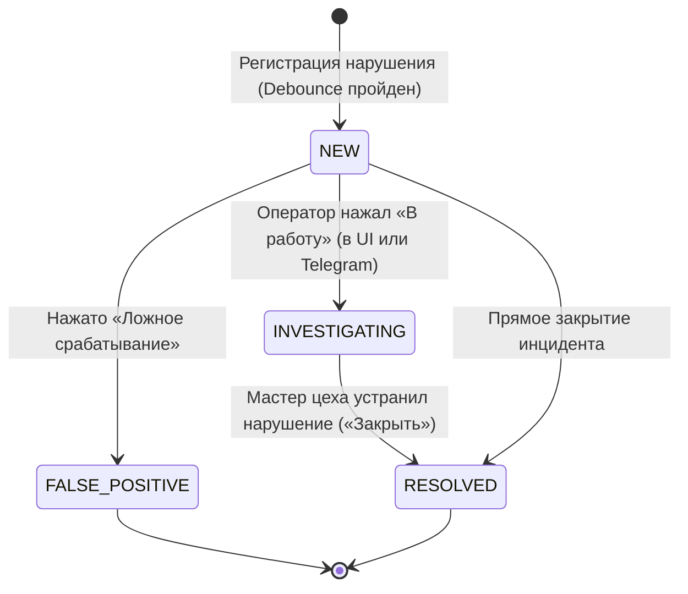

# Архитектура системы LenQsec

Настоящий документ описывает архитектурный дизайн, взаимодействие подсистем, жизненный цикл данных и механизмы отказоустойчивости комплексной платформы интеллектуального контроля промышленной безопасности **LenQsec**.

---

## 1. Обзор архитектурных уровней

Архитектура **LenQsec** построена по модульному принципу с четким разделением вычислительно нагруженных потоков (CPU/TPU-bound) и операций ввода-вывода (I/O-bound):

```text
┌────────────────────────────────────────────────────────────────────────┐
│                        ИСТОЧНИКИ ДАННЫХ                                │
│   RTSP-камеры    Термокамеры (SDK)   Видеофайлы / MP4   Веб-камеры     │
└──────────────────┬───────────────────────────┬─────────────────────────┘
                   │                           │ (матрицы °C)
                   ▼                           ▼
┌─────────────────────────────────────┐ ┌────────────────────────────────┐
│      КОНВЕЙЕР КОМПЬЮТЕРНОГО ЗРЕНИЯ   │ │ РАДИОМЕТРИЧЕСКИЙ ТЕПЛОВИЗИОННЫЙ│
│   • Декодирование кадров (OpenCV)   │ │ КОНТУР                         │
│   • Hardware Abstraction Layer      │ │ • Приём матриц температур      │
│     (LinQ TPU / ONNX CPU / Mock)    │ │ • Зональный контроль порогов   │
│   • Трекер ByteTrack (Track ID)     │ │ • Рендеринг термограмм         │
│   • Safety Rules Engine (Shapely)   │ │ • Стриминг JPEG в Camera Hub   │
│   • Anti-Spam (Debounce + Cooldown) │ └────────────────┬───────────────┘
│   • Дисковая очередь Outbox         │                  │
└──────────────────┬──────────────────┘                  │
                   │ (HTTP REST / JSON + стоп-кадр)       │
                   ▼                                     ▼
┌────────────────────────────────────────────────────────────────────────┐
│                     ЯДРО БЭКЕНДА LENQSEC (FastAPI)                     │
│   • REST API управления камерами, зонами, событиями и аналитикой       │
│   • Storage Provider (Local Disk / S3 Object Storage)                  │
│   • Реляционная СУБД (PostgreSQL / SQLite)                             │
│   • Менеджер многоканальных оповещений (Telegram, WebSockets, Corp SDK)│
└──────────────────┬───────────────────────────┬─────────────────────────┘
                   │ (WebSockets / REST API)   │ (Long-Polling / Webhook)
                   ▼                           ▼
┌─────────────────────────────────────┐ ┌────────────────────────────────┐
│     ВЕБ-ИНТЕРФЕЙС ДИСПЕТЧЕРА        │ │     ОПЕРАТИВНЫЕ КАНАЛЫ СВЯЗИ   │
│   • Мониторинг видео и термограмм   │ │   • Telegram-бот с кнопками    │
│   • Интерактивный редактор полигонов│ │   • Корпоративные мессенджеры  │
│   • Журнал доказательств нарушений  │ │   • СКУД и системы оповещения  │
│   • Сменная аналитика и экспорт CSV │ └────────────────────────────────┘
└─────────────────────────────────────┘
```

---

## 2. Подсистемы и компоненты

### 2.1. Конвейер видеоаналитики (CV Engine)
Процесс `run_worker.py` выполняет автономную обработку потоков:
1. **Source Reader**: чтение кадров с автопереподключением при обрыве RTSP/сети.
2. **HAL (Hardware Abstraction Layer)**:
   - `LinQTPUEngine`: трансляция на чип LinQ TPU через нативную библиотеку `pytpu`.
   - `LocalONNXEngine`: локальный запуск на `onnxruntime` (CPU) с оптимизацией потоков.
   - `MockEngine`: воспроизводимый симулятор для юнит-тестов и CI/CD.
3. **ByteTrack**: ассоциация детекций во времени, сохранение идентичности сотрудников (`Track ID`), расчет векторов скоростей и фильтрация кратковременных окклюзий (перекрытий).
4. **Safety Rules Engine**:
   - `DangerZoneRule`: проверка попадания нижней точки бокса человека в полигоны зон произвольной формы с использованием библиотеки `Shapely`.
   - `PpeRule`: контроль касок (`helmet`) и сигнальных жилетов (`vest`).
   - `FallDetectionRule`: эвристика горизонтального положения ($w/h > 1.2$) и отсутствия перемещения более 2 секунд.
   - `ProximityRule`: контроль евклидовой дистанции между человеком и складской техникой (`forklift`).
5. **Anti-Spam State Machine**:
   - *Temporal Debounce*: регистрация нарушения только при стабильном присутствии $N$ кадров подряд.
   - *Cooldown*: блокировка повторной отправки алерта по тому же `Track ID` на заданный интервал (по умолчанию 300 секунд).
6. **Outbox Client**: гарантированная доставка событий в REST API через локальную дисковую очередь `data/offline_outbox`.

### 2.2. Радиометрический тепловизионный контур
Расположен в `app/routes/thermal.py` и `configs/thermal_cameras.yaml`:
* Принимает матрицы температур $M \times N$ в градусах Цельсия через `POST /api/v1/thermal/cameras/{id}/frame`.
* Вычисляет локальные максимумы по зонам интереса (ROI).
* При превышении порога `max_temperature_c` регистрирует инцидент типа `environment` с сохранением термограммы в хранилище.
* Сбрасывает тревогу при падении температуры ниже `clear_temperature_c`.
* Публикует последний актуальный кадр в `CameraHub` и отдает по маршруту `/api/v1/thermal/cameras/{id}/heatmap.jpg`.

### 2.3. Слой хранения (Storage Layer)
Интерфейс `BaseStorageProvider`:
* **LocalStorageProvider**: локальная директория `storage/snapshots/YYYY-MM-DD/`, сжатие JPEG (качество 80, ~100 КБ).
* **S3StorageProvider**: поддержка объектных хранилищ по протоколу S3 (Yandex Cloud Object Storage, MinIO, AWS S3) с генерацией безопасных Presigned URLs.
* В реляционной БД сохраняются только метаданные и относительный ключ снимка.

### 2.4. Служба уведомлений и интеграций
* **WebSocket Notifier**: рассылка событий `INCIDENT_CREATED` и `INCIDENT_STATUS_UPDATED` всем подключенным веб-клиентам.
* **Telegram Bot Service**: двусторонний long-polling бот. Отправляет карточку с фото/термограммой, описанием нарушения и inline-кнопками управления: «В работу», «Ложное», «Закрыть».
* **5-минутное окно слияния**: повторные фиксации того же типа нарушения на камере не спамят новыми сообщениями, а редактируют уже отправленное сообщение в мессенджере.
* **BaseMessengerAdapter**: абстрактный интерфейс для подключения внешних корпоративных мессенджеров заказчика.

---

## 3. Жизненный цикл инцидента (State Machine)



---

## 4. Отказоустойчивость и безопасность

1. **Изоляция сбоев**: авария процесса CV-воркера не нарушает доступность веб-интерфейса и журнала инцидентов.
2. **Буферизация при сбое сети**: при недоступности API воркер складывает инциденты в `data/offline_outbox` и автоматически синхронизирует их при восстановлении канала.
3. **Безопасность учетных данных**: токены Telegram, конфигурации VPN и ключи S3 передаются исключительно через переменные окружения `.env` и никогда не попадают в код или историю Git.
